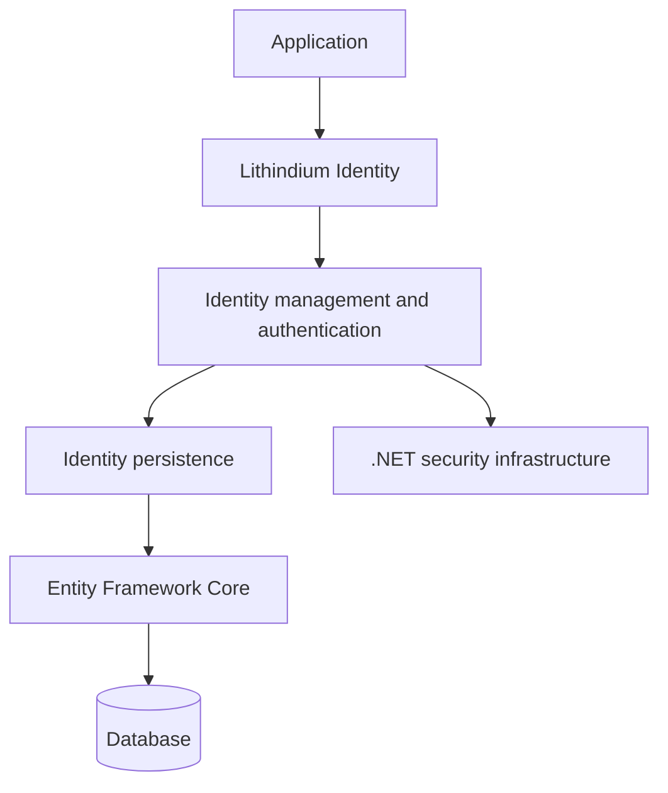

<div align="center">

# Lithindium Identity

**A modern, opinionated identity library for .NET.**

User accounts, authentication, and credential management — without the unnecessary complexity.


[](LICENSE)

[Overview](#overview) · [Features](#features) · [Architecture](#architecture) · [Getting Started](#getting-started) · [Contributing](#contributing)

</div>

---

## Overview

Lithindium Identity is an extensible identity and authentication library for .NET applications, developed by [Visual Fire Development](https://www.visualfiredev.com/).

It brings account management, credential verification, multi-factor authentication, and session management together under a cohesive identity model. The goal is to make building an authentication backend straightforward without requiring applications to implement the same security-sensitive workflows over and over again.

Lithindium is inspired by ASP.NET Core Identity, but takes a more opinionated approach to how user accounts, credentials, and sessions are represented and managed. It builds on established .NET security infrastructure rather than reinventing cryptographic primitives.

> [!IMPORTANT]
> Lithindium Identity is under active development. Its database model is taking shape, but the public API and authentication workflows are not yet complete. It is not ready for production use.

## Features

Lithindium is designed around the following capabilities:

| Capability | Description |
| :--- | :--- |
| **User management** | Unique usernames, optional display names, and explicit account suspension. |
| **Passwords** | Password-based authentication using established password hashing infrastructure. |
| **Email addresses** | Multiple verified email addresses with optional primary address selection. |
| **Phone numbers** | Multiple verified phone numbers, including extensions and primary number selection. |
| **Multi-factor authentication** | Multiple named TOTP authenticators per account. |
| **Recovery codes** | Secure, single-use recovery codes for account access. |
| **Session management** | Individually persisted, expiring, and revocable authentication sessions. |
| **External identities** | Account linking through validated external issuer and subject identifiers. |
| **Account protection** | Authentication lockouts and invalidation of existing credentials. |
| **Auditing** | Persistent records of security-relevant account activity. |

These are design goals, not a list of fully implemented or security-reviewed features.

## Architecture

Lithindium separates application-specific account policy from reusable identity functionality and persistence. Its initial database implementation uses Entity Framework Core, while its identity workflows build on existing .NET security components where appropriate.



The guiding principles are simple:

- **Opinionated by design.** A consistent identity model instead of requiring every application to design its own.
- **Security-conscious.** Reuse established security primitives and keep credential-sensitive operations within the identity layer.
- **Developer-friendly.** A cohesive, strongly typed API with clear responsibilities and predictable behavior.
- **Application-independent.** Keep business rules, authorization policies, and user interface concerns within the consuming application.

Lithindium is an identity management library, not a complete OAuth 2.0 or OpenID Connect authorization server.

## Getting Started

### Prerequisites

- [.NET 10 SDK](https://dotnet.microsoft.com/download/dotnet/10.0)
- [Git](https://git-scm.com/)

### Building from source

```powershell
git clone https://github.com/visualfiredev/oidc.git
cd oidc
dotnet build dotnet/Lithindium.Identity/Lithindium.Identity/Lithindium.Identity.csproj
```

Installation instructions and public API examples will be added as the library becomes ready for release.

## Contributing

Contributions, ideas, and constructive feedback are welcome. Bug reports, feature proposals, and pull requests can be submitted through GitHub.

For suspected security vulnerabilities, please use a private reporting channel rather than opening a public issue.

## License

Lithindium Identity is licensed under the [Apache License, Version 2.0](LICENSE).

Copyright © 2026 Visual Fire Development LLC.

---

<div align="center">

Developed by [Visual Fire Development](https://www.visualfiredev.com/).

</div>
