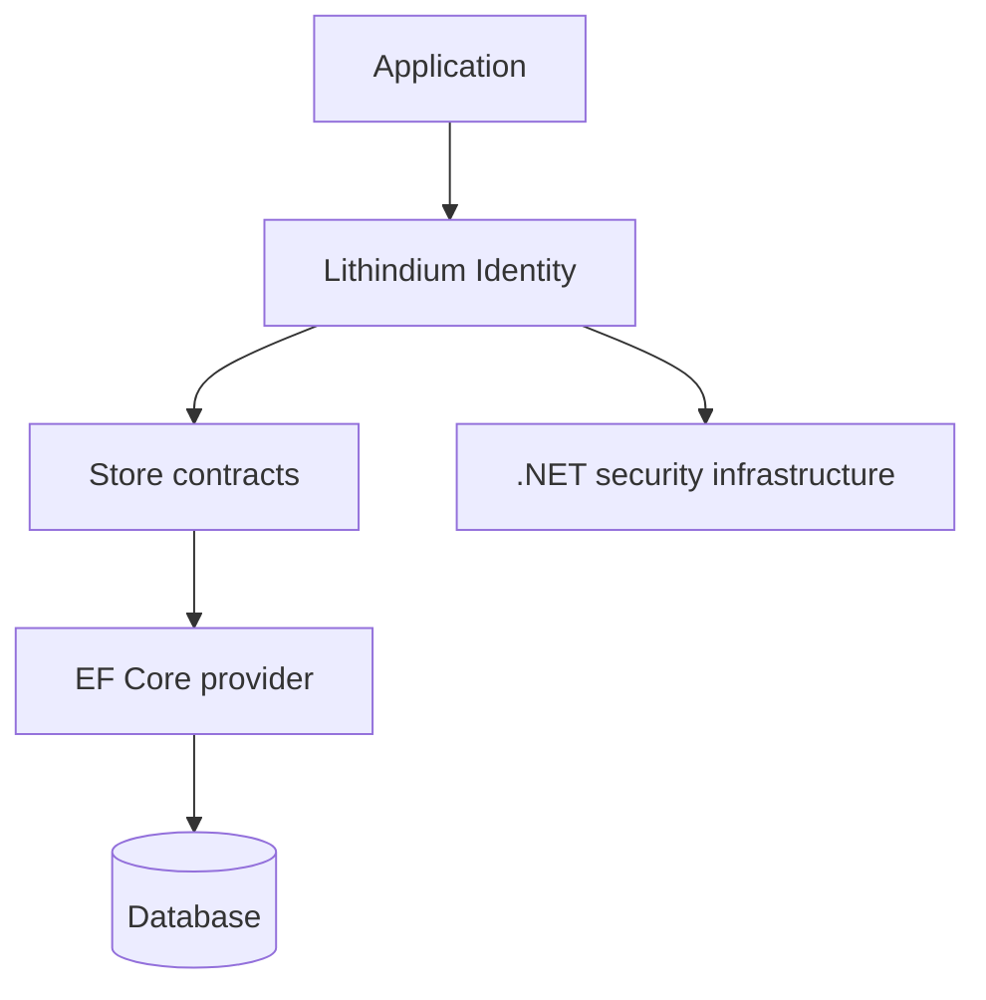

<div align="center">

# Lithindium Identity

**A modern identity and authentication library for .NET.**

User accounts, authentication, and credential management — without the unnecessary complexity.


[](LICENSE)

[Overview](#overview) · [Features](#features) · [Architecture](#architecture) · [Getting Started](#getting-started) · [Contributing](#contributing) · [AI Assisted Development](#ai-assisted-development)

</div>

---

## Overview

Lithindium provides a reusable, consistent identity model for .NET. Inspired by ASP.NET Core Identity, it reuses established security primitives for account and credential management.

> [!IMPORTANT]
> In active development. Authentication workflows and the public API are incomplete; not production-ready.

## Features

Planned capabilities, not completed or security-reviewed features:

| Capability | Description |
| :--- | :--- |
| **User management** | Unique usernames, optional display names, and account suspension. |
| **Passwords** | Established password hashing and verification. |
| **Email addresses** | Multiple verified addresses; optional primary. |
| **Phone numbers** | Multiple verified numbers with extensions; optional primary. |
| **Multi-factor authentication** | Multiple named TOTP authenticators. |
| **Recovery codes** | Secure, single-use access codes. |
| **Challenges** | Expiring, single-use verification and authentication challenges. |
| **Sessions** | Persisted, expiring, individually revocable sessions. |
| **External identities** | Linking by validated issuer and subject. |
| **Account protection** | Lockouts and credential invalidation. |
| **Auditing** | Persistent security event history. |

## Architecture

The core library is persistence-independent. An EF Core provider is planned; identity workflows will reuse .NET security infrastructure.



- **Consistent:** One strongly typed identity model and predictable API.
- **Secure:** Established primitives; credential-sensitive operations stay in the identity layer.
- **Application-independent:** Business rules, authorization and UI remain with the application.

Lithindium is not a complete OAuth 2.0 or OpenID Connect authorization server.

## Getting Started

Requires the [.NET 10 SDK](https://dotnet.microsoft.com/download/dotnet/10.0) and [Git](https://git-scm.com/).

```powershell
git clone https://github.com/visualfiredev/lithindium-identity.git
cd lithindium-identity
dotnet build Lithindium.Identity/Lithindium.Identity/Lithindium.Identity.csproj
```

Installation instructions and API examples will follow.

## Contributing

Ideas, bug reports, proposals and pull requests are welcome on GitHub. Report suspected vulnerabilities privately.

## AI Assisted Development

Human contributors and AI coding agents collaborate under human direction, engineering oversight and review.

All contributions must meet the same correctness, maintainability, security, attribution and licensing standards. Contributors are responsible for their work's quality and legality.

## License

Lithindium Identity is licensed under the [Apache License, Version 2.0](LICENSE).

Copyright © 2026 Visual Fire Development LLC.

---

<div align="center">

Developed by [Visual Fire Development](https://www.visualfiredev.com/).

</div>
